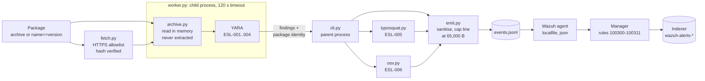

# Eslabon

**Static scanner for PyPI and npm packages. It never installs or runs them. Each finding is one JSON line with ATT&CK IDs, evidence and mitigation text; the bundled Wazuh rules turn each line into one alert.**


> **Status.** 0 false positives on the 194 fully scanned of 200 popular packages (top 100 PyPI + top 100 npm; 6 stopped at Eslabon's caps, no verdict). The content rules (ESL-001..004) have fired only on synthetic fixtures; their detection rate on real malicious packages is **not measured yet** ([roadmap §1](docs/roadmap.md#1-measuring-detection-against-real-samples)). Against 17 inert packages imitating published attack and evasion techniques, it detects 3 ([evasion suite](#synthetic-evasion-suite-3-of-17-detected)).

*Eslabón* is Spanish for "link".

**Contents:** [Overview](#overview) · [Results](#results-at-a-glance) · [What the analyst sees](#what-the-analyst-sees) · [Architecture](#architecture-and-design) · [Rules](#detection-rules) · [Implementation](#technical-implementation) · [Lab and what broke](#lab-validation-and-what-broke) · [Lessons](#lessons-learned) · [Setup](#setup) · [Security and limitations](#security-notes-and-limitations) · [Evasion suite](#synthetic-evasion-suite-3-of-17-detected)

## Overview

Installing a package can run code, and so can importing it. A PyPI sdist runs its `setup.py` at build time, and an npm package runs its `preinstall`, `install` and `postinstall` scripts. ATT&CK files this under T1546.016 (Installer Packages). Malicious packages use it to fetch a second stage, decode hidden code or steal credentials before anyone reads a line. Eslabon reads the package archive in memory, runs six rules over it, and writes one JSON line per finding. A Wazuh agent ships the file. The manager turns each line into one alert.

Package managers are closing part of that door. As of October 2026, npm 12 ([v12.0.0](https://github.com/npm/cli/releases/tag/v12.0.0)), pnpm 10+ ([v10.0.0](https://github.com/pnpm/pnpm/releases/tag/v10.0.0)) and Yarn 4.14+ ([`enableScripts`](https://yarnpkg.com/configuration/yarnrc#enableScripts)) block dependency install scripts by default, and Bun runs them only for a built-in list of trusted packages ([docs](https://bun.sh/docs/install/lifecycle)). But Node.js 22, 24 and 26 still ship npm 10/11 ([nodejs/Release#1161](https://github.com/nodejs/Release/issues/1161)), root-project and workspace scripts still run, and an approved package that is later compromised keeps its scripts. pip still builds sdists by running `setup.py`. Malicious code is also moving to what runs on import and at interpreter startup (`.pth` files and, from Python 3.15, `.start` files, [PEP 829](https://peps.python.org/pep-0829/)), which Eslabon does not judge yet. Sources checked 2026-10-12.

Eslabon is a triage tool for one suspicious package: it tells an analyst what the package would run, maps it to an ATT&CK technique and says what to do. It is not a CI gate for a whole dependency tree; for that, including transitive dependencies, use OSV-Scanner.

GuardDog detects more than Eslabon: more ecosystems and more heuristics. GuardDog 3 tags each finding with ATT&CK tactics, and Datadog Cloud SIEM maps its findings to T1195. None of the tools below emits technique-level ATT&CK, ECS-shaped events with a mitigation and its residual gap into Wazuh, validated end to end. That is the part Eslabon adds.

| Tool | What it gives a SOC |
|---|---|
| GuardDog | JSON/SARIF; ATT&CK tactics per finding; technique T1195 only through Datadog Cloud SIEM, its official SIEM integration. GuardDog 3 also flags URL dependencies and a version that adds install scripts; Eslabon has no rule for either |
| OSV-Scanner | Only what has already been reported. Applies the same OSV `MAL-*` data as ESL-006, but to a whole lockfile including transitive dependencies |
| Packj | Static by default; its optional dynamic mode (strace) executes the package |
| malcontent (Chainguard) | YARA (14,500+ rules) and a diff between two versions; no ATT&CK or SIEM output |
| Socket | Closed source; SIEM integration on paid tiers |
| deps.dev | Enrichment, no detection |

Install-time firewalls (Socket Firewall Free, Aikido Safe Chain, Datadog Supply-Chain Firewall, Veracode Package Firewall, JFrog Curation, Sonatype Repository Firewall) block known malware before or during download. Eslabon does not block; it detects and alerts after download.

Sources, checked 2026-10-12: GuardDog [`v3` branch](https://github.com/DataDog/guarddog/tree/v3) and [Datadog Cloud SIEM rule](https://docs.datadoghq.com/security/default_rules/def-000-yb1/); [OSV-Scanner lockfiles](https://google.github.io/osv-scanner/supported-languages-and-lockfiles/); [Packj](https://github.com/ossillate-inc/packj); [malcontent](https://github.com/chainguard-dev/malcontent); [Socket Firewall Free](https://docs.socket.dev/docs/socket-firewall-free) ([repository](https://github.com/SocketDev/sfw-free)); [Aikido Safe Chain](https://github.com/AikidoSec/safe-chain); [Datadog Supply-Chain Firewall](https://github.com/DataDog/supply-chain-firewall); [Veracode](https://www.veracode.com); [JFrog](https://docs.jfrog.com); [Sonatype](https://www.sonatype.com).

No GuardDog rule was copied. Full comparison: [`docs/design.md` §2](docs/design.md#2-positioning-prior-art). **Stack:** Python 3.13, one runtime dependency (`yara-python` 4.5.4), OSV API, Wazuh 4.14, ECS 9.5-shaped JSON Lines with one documented deviation ([design §6](docs/design.md#6-event-schema)), MITRE ATT&CK v19.2.

## Results at a glance

| Measurement | Result | Source |
|---|---|---|
| Lab run, Kali agent to Wazuh manager, 8 scans of synthetic fixtures | 14 events generated, 14 collected, 14 alerted, **14 indexed** (second pass; the first indexed 0, [see why](#pass-1-every-alert-fired-the-index-held-nothing)) | [`docs/evidence/lab/`](docs/evidence/lab/README.md) |
| False positives, top 100 PyPI + top 100 npm | **0** on the 194 fully scanned; 6 stopped at Eslabon's caps, no verdict (4 the 5,000-member cap, 2 the 10 MiB per-file cap) | [`docs/measurements.md`](docs/measurements.md) |
| Typosquat false positives, ranks 5,001-6,000 | 14 / 1,000 on PyPI, 11 / 1,000 on npm | [`docs/measurements.md`](docs/measurements.md) |
| ESL-005 name recall on known-malicious typosquat names (OSV MAL) | PyPI 442/455, npm 90/121; historical squats PyPI 6/6, npm 1/8 | [`docs/measurements.md`](docs/measurements.md) |
| Time per package | scan only: median 0.34 s, max 4.0 s; with download and OSV: median 2.6 s, max 11.8 s | [`docs/measurements.md`](docs/measurements.md) |
| Test suite | Kali: 975 passed, 9 skipped (Windows-only) at pass 1; host: 1,001 passed at pass 2 (session output, not saved as a log) | [`docs/evidence/lab/README.md`](docs/evidence/lab/README.md) |
| Synthetic evasion suite, 17 inert packages imitating published techniques | **3 detected, 14 pass as clean** (exit 0, no anomaly) | [Evasion suite](#synthetic-evasion-suite-3-of-17-detected) |
| **Detection rate of the content rules (ESL-001..004) on real malicious packages** | **Not measured.** Planned against DataDog's malicious-packages dataset | [`docs/roadmap.md`](docs/roadmap.md#1-measuring-detection-against-real-samples) |

## What the analyst sees

A `wazuh-logtest` sample of an ESL-006 finding. A synthetic archive declares the name `paypalize` 1.0.0, which has an OSV malware advisory. The sample was generated on Kali by [`scripts/make_logtest_samples.py`](scripts/make_logtest_samples.py), which runs the real scanner with a recorded OSV answer for that name ([`mal_paypalize.json`](tests/data/osv/mal_paypalize.json)). The snippet was redacted before committing. In the lab run, the same fixture fired ESL-006 against the live OSV API (alert 100306, exit code 1). Nothing malicious was downloaded. The event (one line in the file, wrapped here):

```json
{"@timestamp":"2026-10-06T19:57:27.518Z","ecs":{"version":"9.5.0"},
 "event":{"kind":"alert","module":"eslabon","dataset":"eslabon.finding",
          "category":["package","malware"],"type":["info"],"severity":10},
 "package":{"name":"paypalize","version":"1.0.0"},
 "eslabon":{"schema_version":"1.0","attack_version":"19.2","ecosystem":"npm",
  "scan_id":"9388f540d0fc4fbf9f58c0c2b9b5e923",
  "archive":{"sha256":"9496c74e4558c8c26c8f6dbaa378b884fda445a53fc0c03929bcbb76657a1a79"},
  "evidence":{"file":"<osv>","line":0,
              "snippet":"<redacted: synthetic payload, regenerate with scripts/make_logtest_samples.py>",
              "name_hex":"70617970616c697a65","match_count":1},
  "mitigation":{
   "action":"Block installs of versions with an OSV MAL advisory (pin + hash-lock dependencies, private mirror with malware screening).",
   "residual_gap":"Only catches packages someone has already reported; a fresh malicious release is invisible.",
   "detect":"Install-time process/network telemetry from package managers; pair with ESL-001..004."}},
 "rule":{"id":"ESL-006","name":"known-malicious","ruleset":"eslabon","version":"0.1.0"},
 "threat":{"framework":"MITRE ATT&CK",
  "technique":{"id":["T1195.001"],"name":["Compromise Software Dependencies and Development Tools"]},
  "tactic":{"id":["TA0001"],"name":["Initial Access"]}}}
```

The manager's verdict, from `wazuh-logtest` ([`esl-006.txt`](docs/evidence/lab/logtest/pass2-7b981f9/esl-006.txt)):

```
**Phase 3: Completed filtering (rules).
	id: '100306'
	level: '13'
	description: 'Eslabon v2: ESL-006 known-malicious package paypalize 1.0.0 (OSV MAL advisory)'
	groups: '['eslabon_v2', 'supply_chain', 'sigma']'
	firedtimes: '1'
	mail: 'True'
	mitre.id: '['T1195.001']'
	mitre.tactic: '['Initial Access']'
	mitre.technique: '['Compromise Software Dependencies and Development Tools']'
**Alert to be generated.
```

Every rule in [`catalog.toml`](src/eslabon/catalog.toml) carries three text fields for the analyst:

- **`mitigation.action`**: what to change so this cannot happen again.
- **`mitigation.residual_gap`**: what the mitigation and the rule still miss. Here: a fresh release nobody has reported.
- **`mitigation.detect`**: where to look for what slipped through.

Wazuh stores Eslabon's own rule ID (`ESL-006`) as `data.rule.id`, next to its own `rule.id` (`100306`). Both are searchable. Snippets are redacted before committing, so the repository holds no payloads.

## Architecture and design



| Host | Role | Software | Address |
|---|---|---|---|
| Kali 2026.2 | Runs the scans; Wazuh agent (ID 001) | Python 3.13.12, agent 4.14.0-1 | 192.168.56.102 |
| Wazuh OVA | Manager, indexer, dashboard | Wazuh 4.14.0 (OVA, rc2) | 192.168.56.101 |
| Windows 11 | Hypervisor; runs the test suite and the false-positive corpus | VirtualBox on Hyper-V | n/a |

The VMs share a VirtualBox host-only network, 192.168.56.0/24. The agent was stripped on purpose: its 10 default `<localfile>` blocks removed, syscheck, rootcheck, syscollector and SCA disabled. With the agent stripped and every count filtered by `scan_id`, the counts include only Eslabon events. The lab fixtures and logtest samples were built and scanned only on Kali; the host builds its test fixtures in memory at test time and scans only the legitimate corpus.

### Nothing from the package is executed

Eslabon never imports, extracts or runs package content. YARA reads bytes in memory. Ruff's `S` rules flag `subprocess` and `exec` in `src/`, which has no `S` exemptions ([`pyproject.toml`](pyproject.toml)); the worker child is started with `multiprocessing` and runs Eslabon's own analysis code. The lint is a check, not a guarantee. The cost: behaviour that only appears at runtime is invisible.

### An incomplete scan is never a clean scan

In a SIEM, zero findings and a scan that never arrived look the same. So every scan writes one summary event (`eslabon.scan`) with a status, even when it finds nothing. `ok` goes to rule 100310 at level 3, the lowest level indexed by default (`log_alert_level` 3). Nothing alerts yet when scans stop arriving; the level-3 events make that check possible. Any other status (`timeout`, `limits_exceeded`, `parse_error`, `hash_mismatch`, `fetch_error`, `incomplete`, `osv_unavailable`) goes to 100311 at level 7.

The exit code follows the same logic: `0` clean, `1` findings, `2` error or incomplete scan. `2` wins over `1`, and the findings are still written. A hash mismatch, OSV being unreachable or one unscanned member is exit 2, never 0.

Never allow-list exit 2 in CI. Treat it as "not cleared" and triage it by `eslabon.scan.status`: a package can be padded on purpose so that it ends with no verdict instead of clean ([limitations](#what-this-does-not-detect)). Findings from the members read before a cap are still emitted.

## Detection rules

| ID | Fires when | ATT&CK | Wazuh rule / level |
|---|---|---|---|
| ESL-001 | `setup.py` uses the network, or shells out with a download tool or URL | T1546.016, T1059.006 | 100301 / 11 |
| ESL-002 | An npm install script downloads, pipes to a shell, runs inline code (`node -e`) or holds a URL | T1546.016, T1059.007 | 100302 / 11 |
| ESL-003 | `eval`/`exec`/`Function` sits next to a decoder (base64, hex, zlib, `atob`) | T1027.013, T1140 | 100303 / 12 |
| ESL-004 | A credential source and an exfil sink appear in the same file | T1552.001, T1041 | 100304 / 12 |
| ESL-005 | Name is 1 edit (or a restricted 2) from a top-1,000 name; npm scope squat (`@evil/react`) | T1195.001 | 100305 / 7 |
| ESL-006 | OSV has a non-withdrawn `MAL-*` advisory for this name and version | T1195.001 | 100306 / 13 |

ESL-001, 003 and 004 are YARA rules in [`src/eslabon/rules/`](src/eslabon/rules/). ESL-002 parses `package.json`, then applies YARA and a token check. ESL-005 and 006 are plain Python. ESL-005 flags trailing digits on purpose: `urllib33` and `beautifulsoup44` were real malicious packages. Exact triggers and known misses: [`docs/design.md` §5](docs/design.md#5-heuristics); results against evasions: [evasion suite](#synthetic-evasion-suite-3-of-17-detected).

**Wazuh rule tree.** Parent 100300 (level 0) matches the built-in `json` decoder, the location suffix `events.jsonl$` and `event.module: eslabon`. Under it sit 100301-100306 (one per rule), 100310 (summary `ok`) and 100311 (any other status). No custom decoder is needed. Wazuh stops at the first matching leaf, so each event becomes exactly one alert. No rule goes above level 13. In my previous lab project (Proyecto-1), a level-15 rule fired 60 times on benign activity, and I stopped reading level 15.

**Sigma, translated by hand.** Wazuh has no official pySigma backend. [`eslabon_v2_known_malicious.yml`](integrations/sigma/eslabon_v2_known_malicious.yml) was translated by hand into rule 100306, which is why that alert carries the `sigma` group. A separate Sigma rule would compete with 100306 for the same event, and one of the two alerts would never appear. Every field match uses `type="pcre2"`, because in Wazuh's default regex `\.` matches any character. Notes: [`integrations/sigma/MAPPING.md`](integrations/sigma/MAPPING.md).

## Technical implementation

```
src/eslabon/
  cli.py, fetch.py, worker.py   # arguments and exit codes; HTTPS download + hash; child process with timeout
  archive.py                    # streaming tar/zip/wheel reader, caps, anomalies
  yara_engine.py, rules/        # ESL-001..004 YARA rules, per-call timeout
  npm_scripts.py                # ESL-002: package.json lifecycle scripts
  typosquat.py, data/           # ESL-005: Damerau-Levenshtein against bundled top lists
  osv.py                        # ESL-006: api.osv.dev query, MAL-* only
  names.py, sanitize.py         # name normalisation; strip control chars, ANSI, bidi
  emit.py                       # JSON Lines writer, 65,000-byte line cap
  catalog.toml                  # every rule: ATT&CK, severity, Wazuh level, mitigation
schema/                         # JSON Schema for every event
integrations/wazuh/, sigma/     # rules XML, agent snippet, install guide; Sigma rule + mapping
corpus/legit.toml, scripts/     # pinned 200-package corpus; measurement and sample scripts
docs/, docs/evidence/lab/       # design, schema, measurements, roadmap; raw lab output
tests/                          # pytest suite; fixtures built in memory (builders.py)
```

**CLI:** `eslabon scan <archive | name==version> --ecosystem {pypi,npm} [--out FILE] [--offline]`. Inputs: `.tar.gz`, `.tgz`, `.tar.bz2`, `.zip`, `.whl` or `name==version`. `--ecosystem` is required except for `.whl`. Events are appended to `--out` (default `events.jsonl`). `--offline` skips OSV and records `osv_status: skipped`. A usage error prints one line to stderr, exits 2 and writes no event. Every field: [`docs/event-schema.md`](docs/event-schema.md), enforced by [`schema/event.schema.json`](schema/event.schema.json).

## Lab validation and what broke

The lab evidence lives in `docs/evidence/lab/`; each file name carries the commit the pass ran at (pass 1 `e660c1e`, pass 2 `7b981f9`). Two passes of the same 8 scans: 6 scans with one finding each (one per rule), 1 clean scan and 1 incomplete scan, so 6 findings, 7 summaries with status `ok` and 1 with status `incomplete`. I counted the events at four layers, filtered by `scan_id` ([pass 1](docs/evidence/lab/counts-pass1-e660c1e.txt), [pass 2](docs/evidence/lab/counts-pass2-7b981f9.txt), [environment log](docs/evidence/lab/README.md)).

| Layer | Pass 1 | Pass 2 |
|---|---|---|
| Generated (`events.jsonl` on Kali) | 14 | 14 |
| Collected (manager `archives.json`) | 14 | 14 |
| Alerted (manager `alerts.json`) | 14 | 14 |
| **Indexed** (`wazuh-alerts-*`) | **0** | **14** |

### Pass 1: every alert fired, the index held nothing

The rules engine alerted on all 14 events. The dashboard showed none. Filebeat logged 14 rejections like this one ([`filebeat-pass1-e660c1e.txt`](docs/evidence/lab/filebeat-pass1-e660c1e.txt)):

```
mapper_parsing_exception","reason":"failed to parse field [data.file] of type [keyword] ...
Preview of field's value: '{hash={sha256=c64c316db5584bcc71dc92174fa7cdf472deaf07d4a30aa597ae36aabff19747}}'"
```

Wazuh's index template maps `data.file` as a keyword. Eslabon followed ECS and wrote the archive hash as an object, `file.hash.sha256`. Wazuh nests every field under `data.`, the two collided, and the indexer dropped the whole document. The fix moved the hash to `eslabon.archive.sha256`, a documented ECS deviation ([`docs/design.md` §6](docs/design.md#6-event-schema)). Pass 2 re-ran all four layers: 14 indexed, 0 filebeat errors.

### Long lines vanish, and the error blames the wrong line

To find the real line limit I wrote one large line followed by two small sentinel lines ([`experiments.py`](docs/evidence/lab/scripts/experiments.py)).

| Large line | Large line result | Sentinel 1 | Sentinel 2 |
|---|---|---|---|
| 70,000 B | dropped silently | delivered | **lost** |
| 65,300 B (allowed by the old 65,536 cap) | dropped silently | delivered | **lost** |
| 65,000 B (new cap) | delivered and alerted, **not indexed** | delivered | delivered |

The agent's only complaint named a 219-byte line, not the large one ([`kali-state.txt`](docs/evidence/lab/kali-state.txt)):

```
2026/10/06 15:28:53 wazuh-logcollector: ERROR: Large message size from file '/var/log/eslabon/events.jsonl' (length = 219): ...
```

Measured: 65,000 B arrives, 65,300 B is dropped. The logcollector source puts the limit at 65,278 bytes plus the newline; that figure was read, not measured. The emitter now caps every line at 65,000.

**A second limit, 32,766 bytes per string.** The 65,000-byte line alerted but never reached the index ([`manager-state.txt`](docs/evidence/lab/manager-state.txt)):

```
max_bytes_length_exceeded_exception","reason":"bytes can be at most 32766 in length; got 64780"
```

The template maps dynamic strings as keywords with no `ignore_above`. Eslabon's own string fields are capped at 512 or 1,024 characters, so they cannot hit it. It is now a written schema constraint.

### Wazuh ships ATT&CK v13.1; the events use v19.2

Wazuh's bundled ATT&CK database is v13.1 (since 4.8.0, per the [Wazuh 4.8.0 release post](https://wazuh.com/blog/introducing-wazuh-4-8-0/), checked 2026-10-12). Pass 1 logtest printed `WARNING: Mitre Technique ID 'T1027.013' not found in database.` A per-rule `wazuh_mitre` override in the catalog now tells Wazuh `T1027` for rule 100303. In pass 2 ([`esl-003.txt`](docs/evidence/lab/logtest/pass2-7b981f9/esl-003.txt)) the event carries `['T1027.013', 'T1140']` and tactic `Stealth`; the Wazuh alert shows `['T1027', 'T1140']` and `Defense Evasion`. ATT&CK v18 renamed Defense Evasion to Stealth. An analyst pivoting on the tactic name has to search for both.

### Lab friction

| Problem | Cause | Fix |
|---|---|---|
| Wazuh OVA arrived with a 100% full disk | Vulnerability-detection feed, 13 GB of temp files | Disabled the feature, cleared temp, took a cold snapshot |
| Live snapshot stuck at 90% for about 45 min | VirtualBox on Hyper-V; pausing gave `VERR_VM_UNEXPECTED_UNSTABLE_STATE` | Restored the cold snapshot; cold snapshots only on this host |
| Removed agent came back with the same ID | Removed while still running; it re-enrolled | Stop the agent first, then remove it |
| `wazuh-authd: SSL handshake failed` lines | My own port probes against 1515 | None needed; expected noise from the probes |

After the run the lab was restored and the restore checked: no agent keys, no rules file, no agent package.

## Lessons learned

### What worked well

**Counting four layers.** It located the pass-1 failure at the `alerts.json`-to-indexer hop in one query, without guessing.

**One catalog, enforced by tests.** [`catalog.toml`](src/eslabon/catalog.toml) holds each rule's ATT&CK IDs, severity, Wazuh level and mitigation text. [`tests/test_integrations.py`](tests/test_integrations.py) fails if the Wazuh XML drifts from it. When the ATT&CK override was needed, it was one line in the catalog plus the matching edit in the hand-written XML, and the test failed until both agreed.

**Typosquat tuning against named false positives.** The first version flagged 33 / 1,000 PyPI and 92 / 1,000 npm names; the current one flags 14 and 11. The remaining ones (`willow ~ pillow`, `echarts ~ recharts`) are listed in [`docs/measurements.md`](docs/measurements.md) instead of hidden behind an allowlist.

### Key takeaways

1. **Check the index, not only `alerts.json`.** Pass 1 alerted 14 and indexed 0.
2. **Wazuh drops over-long lines without logging the right line.** Cap lines at 65,000 B and test with sentinel lines.
3. **Wazuh 4.14 maps ATT&CK v13.1** ([since 4.8.0](https://wazuh.com/blog/introducing-wazuh-4-8-0/)). Re-run `wazuh-logtest` per rule after each Wazuh or ATT&CK update.

## Setup

Needs Python 3.13 (`yara-python` 4.5.4 has no 3.14 wheels). Network access is optional with `--offline`; Wazuh 4.14 is needed only for the SIEM part.

Linux (the lab ran on Kali with Python 3.13.12 and an editable dev install, `pip install -e ".[dev]"`; [`kali-install-and-suite.txt`](docs/evidence/lab/kali-install-and-suite.txt)):

```bash
python3 -m venv .venv
.venv/bin/pip install .
.venv/bin/eslabon scan requests==2.34.2 --ecosystem pypi --out req.jsonl
```

Windows:

```powershell
py -3.13 -m venv .venv
.venv\Scripts\pip.exe install .

# Local archive (placeholder path: any npm tarball, e.g. from `npm pack <name>`).
# --offline skips the OSV query (ESL-006).
.venv\Scripts\eslabon.exe scan path\to\package-1.0.0.tgz --ecosystem npm --offline

# From the registry: temp dir, hash verified, scanned in memory, deleted.
# requests 2.34.2 is in the measured false-positive corpus.
.venv\Scripts\eslabon.exe scan requests==2.34.2 --ecosystem pypi --out req.jsonl
# Expected for a clean package: exit code 0 and one eslabon.scan line with "status":"ok".
```

**Scan the wheel pip will install.** For PyPI, `name==version` scans the sdist when there is one, but pip installs a compatible wheel first. To scan the wheel instead, download it without installing and scan the file:

```bash
pip download <name>==<version> --no-deps --only-binary :all: \
    --platform manylinux_2_28_x86_64 --python-version 3.13 --abi cp313 -d wheels/
eslabon scan wheels/<name>-<version>-<tags>.whl
```

`--only-binary :all:` is required: without it, `pip download` of an sdist prepares its metadata by running `setup.py` on your machine. Set `--platform`, `--python-version` and `--abi` to the machine where the package will be installed; without them pip picks the wheel for the analyst's own machine.

**Ship to Wazuh.** On the manager, copy [`eslabon_v2_rules.xml`](integrations/wazuh/eslabon_v2_rules.xml) to `/var/ossec/etc/rules/` (owner `wazuh:wazuh`, mode 660), run `wazuh-analysisd -t`, then restart `wazuh-manager`. On the agent, run `sudo mkdir -p /var/log/eslabon`, add [`agent-ossec.conf.snippet`](integrations/wazuh/agent-ossec.conf.snippet) to `ossec.conf` and restart it. Scans must then write to the watched file with `--out /var/log/eslabon/events.jsonl` (the default `--out` is `./events.jsonl`), or the `<location>` must point at the file you write to:

```xml
<localfile>
  <location>/var/log/eslabon/events.jsonl</location>
  <log_format>json</log_format>
</localfile>
```

Per-rule `wazuh-logtest` checks and the clean-up order: [`integrations/wazuh/README.md`](integrations/wazuh/README.md).

**Develop.** `pip install -e ".[dev]"`, then `python -m pytest` and `python -m ruff check .` from the venv (`.venv/bin/` on Linux, `.venv\Scripts\` on Windows). On Kali the suite gave 975 passed, 9 skipped (Windows-only path tests). Test fixtures are built in memory at test time ([`tests/builders.py`](tests/builders.py)); no archive is committed.

| Symptom | Check |
|---|---|
| Alerts in `alerts.json`, none in the dashboard | Filebeat log for `Cannot index event` (mapping conflict) |
| An event never reaches the manager | Line length; lines of 65,300 B and over were dropped silently in the lab |
| `wazuh-logtest` does not match the parent rule | Run it with `-l /var/log/eslabon/events.jsonl`; without `-l` the location is `stdin` |
| Exit code 2 with findings | The scan was incomplete. Read `eslabon.scan.status` and triage the rest as unscanned |

## Security notes and limitations

The archive is treated as hostile. Full threat model: [`docs/design.md` §8](docs/design.md#8-security-model).

| Threat | Control |
|---|---|
| Decompression bomb | 50 MiB download, 200 MiB decompressed, 10 MiB per file, 5,000 members; ends as `limits_exceeded` |
| Hang | Child process with a 120 s wall-clock timeout; 10 s per YARA call |
| Path traversal, links | Recorded as anomalies; symlinks and hardlinks never followed |
| Duplicate member names | All copies scanned and flagged `duplicate_name` |
| Terminal escapes in evidence | Control characters, ANSI, NUL and bidi overrides stripped; raw name kept as `name_hex` |
| Tampered download | sha256 checked for PyPI, sha512 for npm; sha1-only npm packages flagged `weak_hash_sha1` |
| Network | HTTPS only, fixed allowlist, re-checked on every redirect |

Only synthetic samples have been scanned so far. Real malicious packages will be handled only inside a disposable Kali VM, restored from a cold snapshot afterwards.

### Synthetic evasion suite: 3 of 17 detected

17 inert packages imitating techniques from published attacks and from an external adversarial review: 3 detected, 14 pass as clean (exit 0, no anomaly, so not even `incomplete`). Hosts are under `.invalid` and every payload is `print('hi')` or `console.log('hi')`. The fixtures are built in memory with the test builders ([`tests/builders.py`](tests/builders.py)), and each miss is pinned as a strict expected-failure test in [`tests/test_known_misses.py`](tests/test_known_misses.py), so closing one turns the suite red until this count is updated. Each case, and the rule that should have seen it:

| # | Imitates | Result | Rule that should have seen it, and why it did not |
|---|---|---|---|
| 01 | `curl … \| sh` in `postinstall` | Detected (ESL-002) | |
| 02 | Classic PyPI dropper in `setup.py` | Detected (ESL-001, ESL-003) | |
| 03 | `.npmrc` sent to a Discord webhook | Detected (ESL-004) | |
| 04 | Shai-Hulud 2.0: `preinstall: node setup_bun.js` | Missed | ESL-002 does not judge the file a script runs. ESL-004 sees the credential path, but the exfiltration host (`api.github.com` in the real campaign) is not on its sink list |
| 05 | PhantomRaven: a dependency declared as an `http://` URL | Missed | No rule reads `dependencies` |
| 06 | `g['ev'+'al'](Buffer.from(…))` | Missed | ESL-003 needs the literal `eval(` |
| 07 | `Buffer.from(…)` and `eval(d)` on two lines | Missed | ESL-003 needs decoder and evaluator on the same line |
| 08 | `postinstall: sh setup.sh`, with download-and-run inside `setup.sh` | Missed | ESL-002 judges the script string, not the file it runs |
| 09 | `binding.gyp` with `<!(curl … \| sh)` and no install script | Missed | No rule reads `binding.gyp`; npm runs it through the implicit `node-gyp rebuild` |
| 10 | `CMD = "curl …"`, then `os.system(CMD)` | Missed | ESL-001 needs the download tool or URL inside the call's parentheses |
| 11 | Wheel whose `__init__.py` downloads on import | Missed | ESL-001 reads only an sdist's `setup.py` |
| 12 | Wheel with a `.pth` line that fetches and runs code | Missed | No network rule outside `setup.py`. ESL-003 reads `.pth` files, but fires only with a decoder on the line |
| 13 | `c = b64decode(…)`, then `exec(c)` | Missed | ESL-003 needs decoder and evaluator on the same line |
| 14 | Credentials sent to the attacker's own domain | Missed | ESL-004 has a closed list of exfiltration sinks |
| 15 | Path built as `'.ss' + 'h'` | Missed | ESL-004 needs the literal `.ssh` |
| 16 | In-tree PEP 517 build backend (`backend-path` in `pyproject.toml`) | Missed | ESL-001 is scoped by file name to `setup.py` |
| 17 | `getattr(builtins, 'exec')(…)` | Missed | ESL-003 needs the literal `exec(` |

Six misses are syntax (06, 07, 10, 13, 15, 17): the rules match literals within one line. The other eight are scope: the file, key or host that carries the payload is never judged. Not counted in the 17: a clean sdist next to a wheel carrying an encoded payload. Scanned as a local file, the wheel fires ESL-003; `name==version` picks the sdist and exits 0.

### What this does not detect

| Limitation | Details |
|---|---|
| **Detection rate on real malware is not measured.** Planned against DataDog's malicious-packages dataset | [`docs/roadmap.md` §1](docs/roadmap.md#1-measuring-detection-against-real-samples) |
| **14 of 17 synthetic evasions pass as clean.** The rules match literals within one line or one file: a value staged in a variable, split across two lines, built by concatenation or reached through an alias of `exec`/`eval` evades them, and so does exfiltration to an ordinary domain. ESL-001 also misses a `setup.py` that fetches through a helper module; ESL-005 misses names outside the top 1,000; ESL-006 misses releases nobody has reported | [Evasion suite](#synthetic-evasion-suite-3-of-17-detected), [`docs/roadmap.md` §7](docs/roadmap.md#7-rule-extensions) |
| PyPI `name==version` scans one artifact per version (the sdist when there is one); pip installs a compatible wheel first, so a clean sdist next to a malicious wheel scans clean. Scan the wheel you will install as a local file ([how](#setup)). GuardDog also scans one archive per PyPI version ([`v3` README](https://github.com/DataDog/guarddog/tree/v3), checked 2026-10-12) | [`docs/design.md` §4](docs/design.md#4-architecture) |
| Code that runs when a wheel is imported (`__init__.py`, case 11). `.pth` files are read by ESL-003 and ESL-004, but a `.pth` `import` line that fetches or runs code is not judged (case 12); neither are Python 3.15 `.start` startup files | [`docs/roadmap.md` §2](docs/roadmap.md#2-code-that-runs-on-import-or-at-interpreter-startup) |
| An in-tree PEP 517 build backend, which pip runs at build time like `setup.py` (case 16) | [`docs/roadmap.md` §7](docs/roadmap.md#7-rule-extensions) |
| The file an install script runs (`node setup.js`, case 04; `sh setup.sh`, case 08). In it, only decoding next to an evaluator on the same line and a credential path next to a known exfiltration sink are checked; download-and-run is not. A legitimate installer (esbuild, puppeteer) also downloads and runs a binary, so a future rule cannot flag that shape alone; it would target fetched text executed as code, or the whole environment sent over the network | [`docs/roadmap.md` §7](docs/roadmap.md#7-rule-extensions) |
| `binding.gyp` command expansions (`<!(...)`), which node-gyp runs at install when the package has no install script (case 09). The Miasma campaign (June 2026) used `<!(node index.js > /dev/null 2>&1 && echo stub.c)` to run the package's own `index.js` with no install script at all ([Snyk](https://snyk.io/blog/node-gyp-supply-chain-compromise-self-propagating-npm-worm-binding-gyp/), checked 2026-10-12). npm 12 blocks dependency install scripts by default; npm 10/11, still bundled with Node 22/24/26, does not | Not tracked yet |
| Dependencies a package declares by URL or git (`http://`, `git+`, `github:`; case 05, the PhantomRaven shape, [Koi](https://koi.ai/blog/phantomraven-npm-malware-hidden-in-invisible-dependencies), checked 2026-10-12). The registry shows such a package with no dependencies. npm 12 blocks them by default (`allow-git`, `allow-remote`); npm 10/11 does not | Not tracked yet |
| For npm, only the `package.json` inside the tarball is read. If the registry manifest declares different dependencies or scripts (manifest confusion), that difference is not checked | Not tracked yet |
| A package can be padded (thousands of members, or a huge first member) so that it ends with no verdict (exit 2, status `limits_exceeded`) instead of clean. Treat exit 2 as "not cleared", never allow-list it in CI, and triage it by `eslabon.scan.status`; findings from the members read before the cap are still emitted | [`docs/roadmap.md` §3](docs/roadmap.md#3-archive-anomalies-beyond-v01) |
| A member-count or size cap aborts the scan. numpy, scipy, grpcio and ruff hit the 5,000-member cap; lxml and one esbuild binary hit the 10 MiB per-file cap. All end as `limits_exceeded`. Scanning the wheel would not avoid this for most of them: the manylinux x86_64 wheels of numpy, scipy, ruff and grpcio also carry a member over 10 MiB | [`docs/measurements.md`](docs/measurements.md) |
| The zero covers 200 popular, well-maintained packages and says little about the long tail. ESL-001 saw only 36 `setup.py` files, ESL-002 about 3 install scripts | [`docs/measurements.md`](docs/measurements.md) |
| One package at a time: `requirements.txt`, `package-lock.json` and other lockfiles are not read. For a whole dependency tree, including transitive dependencies, use [OSV-Scanner](https://google.github.io/osv-scanner/supported-languages-and-lockfiles/) (it reports known malware, not new code) | [`docs/roadmap.md` §4](docs/roadmap.md#4-dependency-files) |
| No entropy, metadata or bundled-binary signals | [`docs/roadmap.md` §5](docs/roadmap.md#5-entropy-metadata-signals-steganography-bundled-binaries) |
| Designed to share a manager with [eslabon v1](https://github.com/GTosetti/eslabon) (rules 100300-100399, group `eslabon_v2`, file `events.jsonl`); not tested together. v1 orchestrated external scanners (GuardDog, OSV-Scanner and others), accepted a directory or lockfile, emitted SARIF and correlated weak publisher signals; its README states its Wazuh rules were not validated against a real manager. v2 runs its own six rules and validated each rule's alert end to end in the lab, with a technique, a mitigation and a residual gap per finding | [`integrations/wazuh/README.md`](integrations/wazuh/README.md#coexistence-with-eslabon-v1) |

### Out of scope

Not visible inside one archive, or not built:

| Not covered | Why | Where to look |
|---|---|---|
| Account takeover | Needs a diff against the previous release | malcontent's diff mode |
| Poisoned CI/CD (workflow injection, cache poisoning) | Lives in the source repository's workflows, not in the archive | [zizmor](https://github.com/zizmorcore/zizmor), [OpenSSF Scorecard](https://github.com/ossf/scorecard) |
| Dependency confusion | Needs your private package names | Scoped registries, your package index configuration |
| Worm propagation | Happens on the endpoint after install | Endpoint process and network telemetry |
| Hallucinated package names | ESL-005 measures distance to a top-1,000 name, not invented names | |
| Native binary analysis | ESL-003 and ESL-004 only read binaries as bytes | malcontent |
| VS Code / Open VSX extensions, pickled ML models | Other ecosystems | |
| A `prepare` script in a published tarball | Not one of the three lifecycle scripts ESL-002 reads. npm does not run it when installing from the registry, but does for a git dependency, which is how the TanStack compromise ran ([post-mortem](https://tanstack.com/blog/npm-supply-chain-compromise-postmortem), checked 2026-10-12) | |
| MCP servers | They ship as npm or PyPI packages and are scanned as such; instructions injected into tool descriptions are not a file pattern | |

## License

Apache-2.0. See [`LICENSE`](LICENSE).
